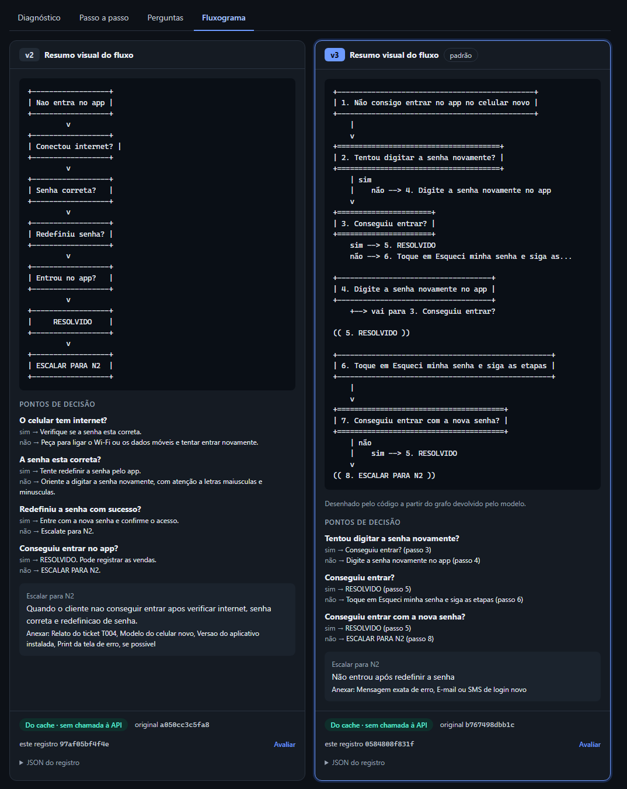
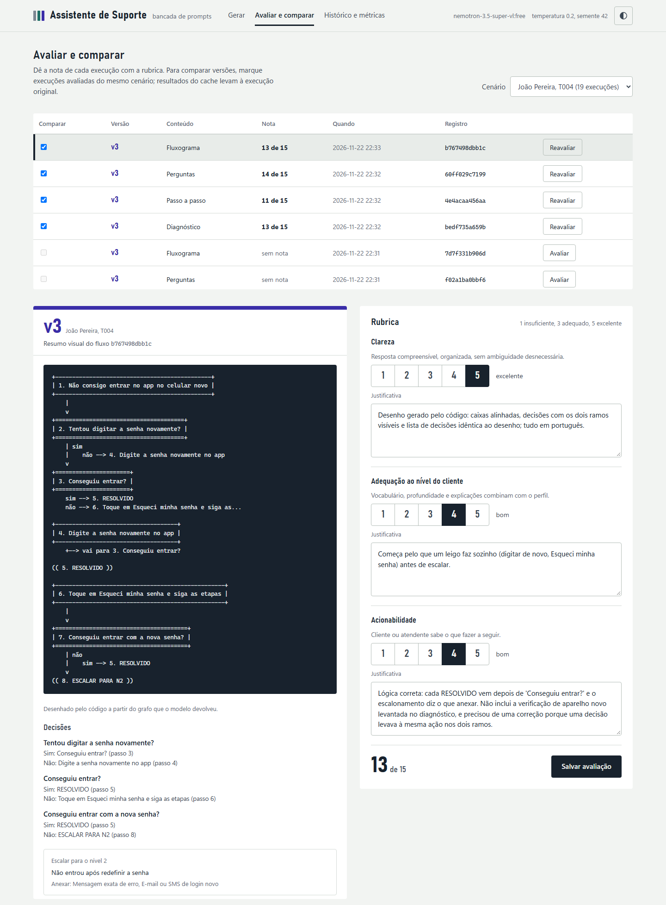
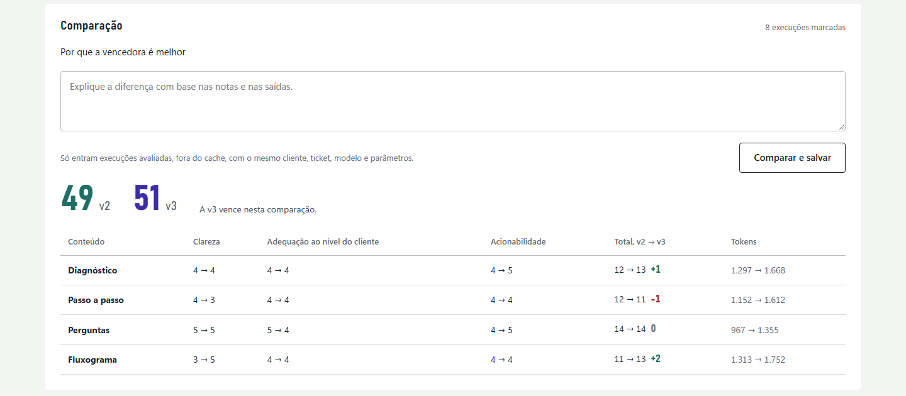
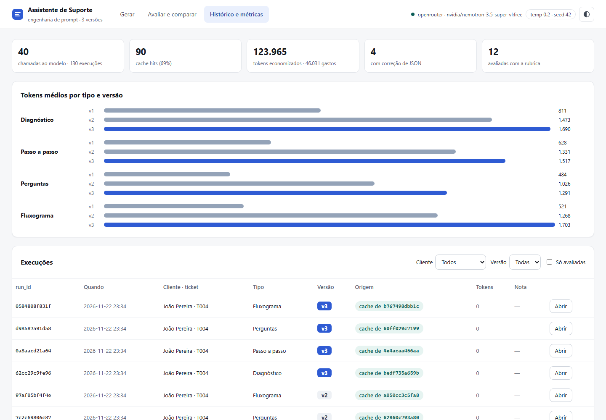

# Assistente de Suporte com Engenharia de Prompt

Este assistente de atendimento recebe um **perfil de cliente** e um **ticket** e gera quatro tipos de conteúdo. Cada tipo tem um prompt próprio e versionado:

| Tipo | id | O que entrega |
|---|---|---|
| Diagnóstico | `diagnosis` | hipóteses, evidências do relato, informações faltantes e conclusão provável |
| Passo a passo | `resolution_steps` | ações em ordem, com resultado esperado, adaptadas ao nível técnico, estilo e canal |
| Perguntas de esclarecimento | `clarifying_questions` | até 3 perguntas priorizadas, só o que muda o próximo passo |
| Resumo visual do fluxo | `flow_summary` | fluxograma ASCII, decisões sim/não e quando escalar (na v3 o modelo devolve um grafo e o código desenha) |

Cada execução é salva em JSON com data/hora, versão do prompt, modelo e configurações. Uma execução equivalente é reaproveitada do cache. As versões de prompt podem ser comparadas com uma rubrica fixa: clareza, adequação ao cliente e acionabilidade, com notas de 1 a 5.

Há três versões de prompt, cada uma guiada pela comparação anterior: v1 (baseline) → v2 (38 → 49 pontos) → v3 (49 → 51, padrão). Na v3, o diagnóstico levanta também causas que o cliente não mencionou, e o passo a passo, as perguntas e o fluxograma recebem esse diagnóstico (prompts encadeados).

Também há:
- uma interface web local;
- validação da saída com JSON Schema;
- log de eventos com tempo, tokens e cache hit;
- 140 testes automatizados que rodam sem chamar a API;
- deploy na Vercel (versão online) e em container (Docker), com limites para uso público.

As decisões de prompt, as comparações v1 × v2 e v2 × v3 e as limitações estão em [PROMPT_ENGINEERING_NOTES.md](PROMPT_ENGINEERING_NOTES.md).

**Para testar sem instalar nada:** <https://prompt-engineering-support-assistan.vercel.app> (detalhes em [Deploy](#deploy)).


*João Pereira (leigo, direto, chat) com o ticket T004 nos prompts v2 e v3. A v3 levanta o bloqueio de segurança por aparelho novo, uma causa que o cliente não citou, marcada como **inferida**, e a nota do diagnóstico na rubrica sobe de 12 para 13.*

## Sumário

- [Requisitos](#requisitos) · [Setup](#setup) · [Variáveis do `.env`](#variáveis-do-env)
- [Como usar](#como-usar): [linha de comando](#linha-de-comando), [avaliação e comparação](#histórico-avaliação-e-comparação), [interface web](#interface-web), [métricas e logs](#métricas-e-logs), [testes](#testes)
- [Arquitetura](#arquitetura) · [Deploy](#deploy) · [Segurança](#segurança) · [Limitações conhecidas](#limitações-conhecidas)

---

## Requisitos

- Python 3.10 ou superior (testado com 3.12).
- Uma chave de API gratuita, de um destes provedores:
  - **OpenRouter** (padrão): crie a chave em <https://openrouter.ai/keys>. Os modelos terminados em `:free` não têm custo.
  - **Google Gemini**: crie a chave em <https://aistudio.google.com/apikey>. Em algumas contas o nível gratuito não está disponível (erro 403).

## Setup

**Windows (PowerShell)**

```powershell
git clone https://github.com/Arturvpf/prompt-engineering-support-assistant.git
cd prompt-engineering-support-assistant
python -m venv .venv
.\.venv\Scripts\Activate.ps1
pip install -r requirements.txt
Copy-Item .env.example .env
notepad .env
```

**Linux / macOS**

```bash
git clone https://github.com/Arturvpf/prompt-engineering-support-assistant.git
cd prompt-engineering-support-assistant
python3 -m venv .venv
source .venv/bin/activate
pip install -r requirements.txt
cp .env.example .env
```

No `.env`, preencha `OPENROUTER_API_KEY`. Para usar o Gemini, troque `LLM_PROVIDER=gemini` e preencha `GEMINI_API_KEY`. O `.env` está no `.gitignore` e nunca é versionado.

Para conferir a instalação sem gastar chamadas, rode:

```bash
python main.py list
```

### Variáveis do `.env`

| Variável | Padrão | Para que serve |
|---|---|---|
| `LLM_PROVIDER` | `openrouter` | `openrouter` ou `gemini` |
| `OPENROUTER_API_KEY` / `GEMINI_API_KEY` | (vazio) | chave do provedor escolhido |
| `OPENROUTER_MODEL` | `nvidia/nemotron-3.5-super-vl:free` | se der 429, troque por outro modelo `:free` |
| `GEMINI_MODEL` | `gemini-2.5-flash` | modelo do Gemini |
| `LLM_TEMPERATURE` | `0.2` | baixa, para respostas mais estáveis |
| `LLM_MAX_OUTPUT_TOKENS` | `2048` | limite de tokens da resposta |
| `LLM_SEED` | `42` | reduz a variação entre execuções (`none` desativa) |
| `LLM_THINKING_BUDGET` | `0` | desativa o raciocínio interno do modelo (`none` usa o padrão) |
| `LLM_TIMEOUT_SECONDS` | `60` | tempo limite por chamada |
| `LLM_MAX_RETRIES` | `3` | novas tentativas em 408, 429, 5xx e falhas de rede |
| `OUTPUT_DIR` | `outputs` | pasta do `history.json` (histórico e cache) e de `logs/events.jsonl` |
| `LOG_LEVEL` | `WARNING` | eventos mostrados no terminal (`DEBUG`, `INFO`, `WARNING`, `ERROR`); o arquivo de eventos registra sempre a partir de `INFO` |

As variáveis da interface web (`HOST`, `PORT` e `WEB_*`) só importam para expor a web na rede. Elas estão na seção [Deploy](#como-a-instalação-pública-se-protege) e comentadas no `.env.example`.

---

## Como usar

### Modo interativo (menus)

```bash
python main.py
```

Os menus pedem, em ordem:

1. O perfil do cliente.
2. O ticket: um dos exemplos ou um texto novo.
3. O tipo de conteúdo, ou os 4 de uma vez.
4. A versão do prompt, ou "Comparar todas as versões".

A saída aparece formatada no terminal, junto com o caminho do JSON salvo e o `run_id`.

### Linha de comando

```bash
# perfis, tickets, tipos de conteúdo e versões disponíveis
python main.py list

# os 4 tipos para um cliente e um ticket de exemplo, com o prompt v3 (padrão)
python main.py generate -c marta-leigo-telefone -t T001

# um tipo, com um ticket novo digitado na hora
python main.py generate -c rafael-avancado-chat --text "A API retorna 500 ao criar pedido desde ontem" --type diagnosis

# o mesmo cenário com duas versões de prompt (para comparar)
python main.py generate -c joao-leigo-chat -t T004 --type all -v v2 v3

# ignorar o cache / imprimir o registro completo em JSON
python main.py generate -c joao-leigo-chat -t T004 --type diagnosis --no-cache
python main.py generate -c joao-leigo-chat -t T004 --type diagnosis --json
```

### Histórico, avaliação e comparação

> **Como comparar versões de prompt: gerar → avaliar → comparar**
> 1. **Gere** o mesmo cliente + ticket com duas ou mais versões (v1, v2, v3), com o mesmo modelo e os mesmos parâmetros.
> 2. **Avalie** cada execução com a rubrica: clareza, adequação ao cliente e acionabilidade, de 1 a 5, cada nota com justificativa.
> 3. **Compare.** Só entram execuções **avaliadas** e **geradas pelo modelo**. Um resultado do cache é cópia de outro registro, então a nota e a comparação ficam na execução original, que o próprio resultado indica.
>
> A comparação isola a versão do prompt: execuções com cliente, ticket, provedor, modelo ou parâmetros diferentes são recusadas. Comparar modelos não é o objetivo; trocar o modelo mudaria duas variáveis ao mesmo tempo e a comparação deixaria de ser justa.

```bash
# execuções salvas, com run_id, origem (modelo ou cache) e nota
python main.py history -c joao-leigo-chat -t T004

# avaliar uma execução com a rubrica: sem argumentos, pergunta nota e justificativa de cada critério
python main.py evaluate a2cf94288d19

# ou passar as notas na linha de comando
python main.py evaluate a2cf94288d19 --clarity 4 "Organizado..." --customer-fit 3 "..." --actionability 3 "..."

# ou passar as notas por arquivo JSON: {"clarity": {"score": 4, "justification": "..."}, ...}
python main.py evaluate a2cf94288d19 --file notas.json

# comparar execuções avaliadas do mesmo cenário (pode juntar vários tipos)
python main.py compare a2cf94288d19 524bbca9b910 --verdict "Por que a v2 é melhor..."
```

O `compare` recusa execuções que diferem em algo além da versão do prompt (cliente, ticket, provedor, modelo ou configurações). Também recusa execuções sem avaliação e registros vindos do cache. Por padrão, salva o resultado em `outputs/comparisons/`; use `--out` para escolher outro caminho.

Os `run_id` acima são os da comparação em [`samples/`](samples/). Num clone novo o histórico começa vazio: use os `run_id` que o `generate` e o `history` mostrarem, ou carregue o histórico de exemplo como explicado a seguir.

#### Reproduzir a comparação v1 × v2 sem chave de API

O arquivo [`samples/history_comparison_joao-leigo-chat_T004.json`](samples/history_comparison_joao-leigo-chat_T004.json) está no mesmo formato do `history.json`. Copie-o para uma pasta separada e aponte `OUTPUT_DIR` para ela. O `history` e o `compare` funcionam sem chamar a API:

```powershell
# Windows (PowerShell)
New-Item -ItemType Directory -Force demo | Out-Null
Copy-Item samples\history_comparison_joao-leigo-chat_T004.json demo\history.json
$env:OUTPUT_DIR = "demo"
python main.py history
python main.py compare a2cf94288d19 524bbca9b910 39d4ea594be4 9c2cf899bd60 ca699d54d804 62960c793a80 1e5783f19ae3 a050cc3c5fa8 --verdict "..."
Remove-Item Env:OUTPUT_DIR
```

```bash
# Linux / macOS
mkdir -p demo && cp samples/history_comparison_joao-leigo-chat_T004.json demo/history.json
OUTPUT_DIR=demo python main.py history
OUTPUT_DIR=demo python main.py compare a2cf94288d19 524bbca9b910 39d4ea594be4 9c2cf899bd60 ca699d54d804 62960c793a80 1e5783f19ae3 a050cc3c5fa8 --verdict "..."
```

O resultado é a mesma tabela de `samples/comparison_v1_v2_joao-leigo-chat_T004.json`: v1 = 38, v2 = 49. A mesma comparação também pode ser feita pela [interface web](#interface-web).

Para a comparação v2 × v3, use `samples/history_comparison_v2_v3_joao-leigo-chat_T004.json` do mesmo jeito, com estes `run_id`. O resultado é v2 = 49, v3 = 51:

```bash
python main.py compare 524bbca9b910 bedf735a659b 9c2cf899bd60 4e4acaa456aa 62960c793a80 60ff029c7199 a050cc3c5fa8 b767498dbb1c --verdict "..."
```

### Interface web

```bash
python main.py web            # abre em http://127.0.0.1:8000
python main.py web --port 8080
```

A interface tem três telas.

#### Gerar

- O cenário é uma frase: "Atender **[cliente]** sobre **[ticket]** com **[v1] [v2] [v3]**". Abaixo dela aparecem o perfil do cliente e a mensagem dele; também dá para escrever outro problema.
- Cada versão do prompt tem a sua cor, mais escura a cada versão: v1 grafite, v2 petróleo, v3 índigo. Os resultados aparecem por tipo, com uma coluna por versão.
- Cada coluna mostra a nota da rubrica em destaque. Num resultado vindo do cache, a nota é a da execução original.
- Cada tipo tem uma apresentação própria:
  - hipóteses com um medidor de probabilidade e marca-texto nas inferidas;
  - passos numerados com o resultado esperado;
  - perguntas com o motivo e onde encontrar a resposta;
  - o fluxograma com as decisões.
- A faixa abaixo do cabeçalho diz de onde veio o resultado:
  - "Reaproveitado do cache, sem chamar a API. Original `524bbca9b910`, este registro `…`";
  - "Gerado agora em 3,3 s. 1.668 tokens, 1 tentativa".
- Na v3, mostra também qual diagnóstico alimentou o prompt.



*Fluxograma da v2 (desenhado pelo modelo, em linha reta e sem os ramos das decisões) e da v3 (o modelo devolve um grafo e o código desenha, com os dois ramos de cada decisão à vista).*

#### Avaliar e comparar

- Mostra as execuções de um cenário (mesmo cliente, ticket, modelo e parâmetros). Você dá as notas da rubrica na própria tela, com justificativa obrigatória. Uma execução já avaliada abre com as notas preenchidas.
- O "Avaliar" de um resultado vindo do cache abre a execução original.
- Marque execuções avaliadas para gerar a comparação, salva em `outputs/comparisons/`. A caixa de marcar só fica ativa depois que a execução tem nota (o fluxo completo está em [Histórico, avaliação e comparação](#histórico-avaliação-e-comparação)).





#### Histórico e métricas

Mostra chamadas ao modelo, cache hits, tokens gastos e economizados, tokens médios por tipo e versão, e a lista de execuções com filtros.



#### Links diretos

Cada tela tem um endereço, útil para compartilhar ou documentar. As imagens acima foram geradas assim:

| Link | Abre |
|---|---|
| `/#gerar?cliente=joao-leigo-chat&ticket=T004&versoes=v2,v3&aba=flow_summary&gerar=1` | gera (ou busca no cache) e mostra a aba escolhida |
| `/#avaliar?run=b767498dbb1c` | a avaliação de uma execução |
| `/#avaliar?run=…&comparar=id1,id2,…` | a avaliação e uma prévia da comparação, sem salvar |
| `/#historico` | histórico e métricas |

Qualquer link aceita `&tema=claro` ou `&tema=escuro`. Valores que não existem nas opções são ignorados.

#### Como funciona

A web usa o mesmo serviço, histórico e cache da CLI. Tudo o que vem do modelo é inserido como texto (`textContent`), nunca como HTML. A página não carrega nada de fora (CSP `default-src 'self'`) e funciona offline. O servidor usa só a biblioteca padrão (`http.server`). Por padrão, escuta em `127.0.0.1`, ou seja, só nesta máquina; para expor na rede, veja [Deploy](#deploy). O tema claro/escuro segue o sistema e tem um botão para alternar.

Rotas da API: `GET /api/options`, `POST /api/generate`, `GET /api/history`, `GET /api/run?id=`, `POST /api/evaluate`, `POST /api/compare`, `GET /api/stats` e `GET /api/health`.

Se a porta já estiver em uso, o comando termina com código 1 e sugere outra porta (`--port`). Ele não divide a porta com o outro programa, o que no Windows faria o navegador abrir a aplicação errada.

### Métricas e logs

```bash
python main.py stats          # chamadas, cache hits, tokens gastos e economizados, latência por versão e tipo
python main.py stats --json
```

Cada evento é gravado como uma linha JSON em `outputs/logs/events.jsonl`: geração, cache hit, nova tentativa de chamada, saída inválida, falha e, na web pública, chamada bloqueada pelo teto diário e histórico de demonstração carregado. Exemplo:

```json
{"ts": "2026-11-22T13:25:01.811-03:00", "level": "INFO", "event": "cache_hit", "run_id": "b7ef3f592a98", "source_run_id": "a2cf94288d19", "tokens_saved": 747, "customer_id": "joao-leigo-chat", "ticket_id": "T004", "content_type": "diagnosis", "version": "v1", "model": "nvidia/nemotron-3.5-super-vl:free"}
```

Para ver os eventos também no terminal, use `LOG_LEVEL=INFO` no `.env`. O log nunca recebe a chave de API nem o texto do ticket.

### Exemplo de saída (trecho)

```
========================================================================================
Perguntas de esclarecimento  |  prompt v2  |  openrouter/nvidia/nemotron-3.5-super-vl:free
Cliente: João Pereira (joao-leigo-chat)  |  Ticket: T004
========================================================================================
1. Você está usando o mesmo login (e-mail ou usuário) do celular antigo?
   Motivo: Confirma se o acesso está sendo feito com a conta correta.
   Onde encontrar: No campo de login do aplicativo, onde você digita para entrar.
...
----------------------------------------------------------------------------------------
[cache] Do cache, sem chamada à API. Execução original: 62960c793a80 (o run_id abaixo é o registro deste reaproveitamento).
Salvo em: ...\outputs\history.json  (run_id 887b2b27ea9b)
```

Exemplos completos em JSON estão em [`samples/`](samples/README.md).

### Códigos de saída

| Código | Quando |
|---|---|
| `0` | sucesso |
| `1` | erro esperado (configuração, API, histórico, avaliação) ou algum tipo de conteúdo falhou |
| `2` | entrada inválida (perfil, ticket, versão ou nota inexistente) |
| `130` | cancelado com Ctrl+C |

### Testes

```bash
pip install -r requirements-dev.txt
python -m pytest -q
```

São 140 testes. O modelo é substituído por um cliente falso, então os testes não precisam de chave nem de internet e não gastam cota. Eles cobrem:
- montagem do prompt nas três versões, incluindo regras de estilo, delimitação do ticket, encadeamento do diagnóstico na v3 e o gabarito fora do prompt;
- fluxograma da v3: validação do grafo (nó solto, ligação quebrada, laço sem saída, decisão sem efeito) e desenho alinhado;
- cache (hit, miss, invalidação por versão e por parâmetros, `--no-cache`, hit sem chave);
- validação por schema, incluindo todas as saídas reais de `samples/`;
- correção de JSON, retry com backoff e histórico;
- rubrica e comparação (também pela API da web), configuração, web (incluindo porta em uso e erros 400/403/404/429) e CLI;
- deploy: limite por pessoa, teto diário de chamadas (o cache não conta), histórico de demonstração a partir de `samples/` e configuração por variáveis de ambiente.

O GitHub Actions roda os testes em Python 3.10 e 3.12 a cada push na `main` e em cada PR (`.github/workflows/tests.yml`). Um segundo job constrói a imagem Docker, sobe o container sem chave e confere `/api/health` e o histórico de demonstração.

---

## Arquitetura

```
main.py                      ponto de entrada (python main.py ...)
api/index.py, vercel.json   entrada WSGI e configuração da Vercel (versão online)
Dockerfile, render.yaml      imagem da web e blueprint do Render (container)
data/
  customers.json             5 perfis: nível técnico, estilo, canal e contexto
  tickets.json               4 tickets de exemplo (missing_on_purpose é gabarito, nunca vai ao prompt)
prompts/
  v1/  v2/  v3/              uma pasta por versão; manifest.json descreve a versão, a hipótese e, na v3, as dependências
    persona.md               mensagem de sistema (papel, responsabilidades, limites, formato)
    context.md               perfil + ticket (template com $variaveis)
    <tipo>.md                tarefa e formato JSON de cada tipo de conteúdo
    style_rules.json         (v2, v3) regras de escrita por nível, estilo e canal
schemas/                     JSON Schema de cada tipo de conteúdo (vale para todas as versões)
src/support_assistant/
  data_loader.py             carrega e valida perfis e tickets
  content_types.py           os 4 tipos e os campos obrigatórios de cada um
  prompt_engine.py           monta system + user a partir da versão, do perfil, do ticket e do diagnóstico (v3)
  config.py                  lê o .env (provedor, modelo, parâmetros fixos)
  llm_client.py              cliente Gemini, retry com backoff e classificação de erros
  openrouter_client.py       cliente OpenRouter (API compatível com OpenAI, via httpx)
  generators.py              uma função por tipo; valida o JSON e tenta 1 correção se vier inválido
  flowchart.py               valida o grafo do fluxograma (v3) e desenha o ASCII e os pontos de decisão
  output_validation.py       extrai o JSON da resposta, valida contra o schema e gera avisos de coerência
  history.py                 histórico em JSON com gravação atômica
  service.py                 cache + encadeamento + geração + gravação (a camada que a CLI e a web usam)
  evaluation.py              rubrica, avaliação e comparação justa entre versões
  observability.py           log de eventos em JSON lines e estatísticas do histórico
  formatting.py              saída legível no terminal
  cli.py                     comandos interactive, list, generate, history, evaluate, compare, stats, web
  web.py, static/index.html  interface web local (biblioteca padrão): gerar, avaliar, comparar, histórico
samples/                     exemplos de saída e as comparações v1 x v2 e v2 x v3 completas
docs/images/                 capturas da interface usadas neste README
tests/                       testes com pytest e cliente LLM falso
```

### Fluxo de uma geração

```
perfil + ticket + tipo + versão
        |
        v
v3: passo a passo, perguntas e fluxograma precisam do diagnóstico
        +-- pega o da mesma rodada, ou do cache, ou gera antes
        |
        v
PromptEngine.build()  ->  system (persona.md) + user (context.md + resumo do diagnóstico + <tipo>.md)
        |
        v
chave de cache = sha256(prompt renderizado + tipo + versão + provedor/modelo/parâmetros)
        |
        +-- já existe no history.json? --sim--> registra cache_hit (sem chamar a API)
        |
       não
        v
chamada ao LLM (JSON mode, temperatura 0.2, seed 42, retry em erro temporário)
        |
        v
v3, fluxograma: valida o grafo e desenha o ASCII e os pontos de decisão
        |
        v
valida contra schemas/<tipo>.schema.json  --inválido--> reenvia com o erro anexado (1 vez)
        |
        v
grava o registro em outputs/history.json, registra o evento em outputs/logs/events.jsonl
e mostra no terminal (ou na web)
```

### O que vai em cada registro do histórico

`run_id`, `timestamp`, `customer_id` e `customer`, `ticket_id` e `ticket`, `content_type`, `prompt_version`, `prompt_fingerprint`, `provider`, `model`, `generation_params`, `cache_key`, `upstream` (na v3, o `run_id` do diagnóstico usado no prompt), `cache_hit`, `source_run_id`, `output`, `warnings`, `metrics` (tentativas, latência, tokens, finish_reason) e `evaluation` (notas e justificativas da rubrica).

### Como criar uma versão nova de prompt

1. Copie `prompts/v3` para `prompts/v4`.
2. Edite os arquivos e descreva no `manifest.json` o que mudou, qual a hipótese e de qual comparação veio a ideia (`evidence`). Para encadear tarefas, use `depends_on`; a saída da dependência fica disponível no template como `$<tipo>_context`.
3. Rode `python main.py generate -c <perfil> -t <ticket> -v v3 v4`, avalie com `evaluate` e compare com `compare`.
4. Para torná-la padrão, mude `DEFAULT_VERSION` em `src/support_assistant/prompt_engine.py`.

A versão aparece sozinha no `list` e nos menus. O cache não mistura versões, porque a versão e o prompt renderizado fazem parte da chave.

---

## Deploy

**Versão online:** <https://prompt-engineering-support-assistan.vercel.app>
- Os cenários de `samples/` já estão no cache. Gerar o João + T004 com v1, v2 e v3 responde na hora, com as notas da rubrica, e as comparações aparecem prontas em "Avaliar e comparar".
- Cenários novos chamam o modelo de verdade, com limite por pessoa.

### Vercel (como a versão online foi publicada)

- [`api/index.py`](api/index.py) expõe a mesma aplicação web como WSGI (`web.make_wsgi_app`). O roteador é o mesmo do servidor local (`web.dispatch`).
- [`vercel.json`](vercel.json) põe `src`, `prompts`, `schemas`, `data` e `samples` no pacote da função e dá 60 s por requisição. O [`.vercelignore`](.vercelignore) deixa `.env` e `outputs/` de fora.

Para publicar a sua cópia:
1. Na Vercel, importe o repositório (ou instale o [app da Vercel no GitHub](https://github.com/apps/vercel/installations/new) e crie o projeto). Nenhuma configuração de build é necessária.
2. Em **Settings > Environment Variables**, crie `OPENROUTER_API_KEY` com a sua chave. Sem ela, só o que está no cache funciona.
3. Cada push na `main` publica de novo.

Diferenças da plataforma:
- **Disco:** só `/tmp` aceita escrita, então o histórico fica em `/tmp/outputs` e volta à demonstração de `samples/` quando a instância é recriada.
- **Limites:** o limite por pessoa e o teto diário valem por instância.

### Container (Render, Railway, Fly.io…)

A interface web também roda num container. O [`Dockerfile`](Dockerfile) serve para Render, Railway, Fly.io, Hugging Face Spaces ou qualquer host de containers. A chave da API nunca entra na imagem: ela é passada como variável de ambiente pela plataforma.

### Render (grátis, a partir deste repositório)

O [`render.yaml`](render.yaml) descreve o serviço:
1. No [Render](https://render.com), crie uma conta e escolha **New > Blueprint**.
2. Conecte este repositório. O Render lê o `render.yaml`.
3. Quando ele pedir `OPENROUTER_API_KEY`, cole a sua chave. Ela fica só no painel do Render.
4. Ao terminar o build, o endereço público aparece no painel (algo como `https://prompt-engineering-support-assistant.onrender.com`). A cada push na `main`, o deploy é refeito.

### Docker em qualquer máquina

```bash
docker build -t support-assistant .
docker run --rm -p 8000:8000 --env-file .env -e HOST=0.0.0.0 support-assistant
# abra http://localhost:8000
```

### Como a instalação pública se protege

| Variável | Padrão no container | O que faz |
|---|---|---|
| `HOST` / `PORT` | `0.0.0.0` / `8000` | onde escutar; as plataformas definem `PORT` sozinhas |
| `WEB_TRUST_PROXY` | `true` | usa o IP do `X-Forwarded-For` (o proxy da plataforma) para o limite por pessoa |
| `WEB_RATE_LIMIT` / `WEB_RATE_WINDOW_SECONDS` | `10` / `3600` | no máximo 10 gerações por pessoa por hora; acima disso, HTTP 429 com `Retry-After` |
| `WEB_DAILY_MODEL_CALLS` | `200` | teto de chamadas reais ao modelo por dia. O cache não conta: quando o teto chega, o que já está no cache continua funcionando |
| `WEB_SEED_SAMPLES` | `true` | um histórico vazio começa com as 23 execuções de `samples/`, já avaliadas. As comparações aparecem prontas e repetir esses cenários vem do cache |
| `WEB_ALLOW_EVALUATION` | `true` | `false` desliga a gravação de notas e comparações pela web (HTTP 403) |

Fora do container os padrões são os de uso local: só `127.0.0.1` e sem limites. A interface mostra os limites ativos. `GET /api/health` serve de verificação de saúde para a plataforma e para o `HEALTHCHECK` da imagem. O container roda com um usuário sem privilégios.

**Disco efêmero.** Nos planos grátis, o `outputs/` do container é apagado quando o serviço reinicia ou "dorme" por inatividade. O histórico volta ao estado de demonstração (`samples/`). Para guardar tudo, monte um volume persistente em `/app/outputs`.

---

## Segurança

- As chaves ficam só no `.env`, que está no `.gitignore`. O `.env.example` não tem valores reais. A configuração nunca imprime a chave.
- O relato do cliente vai entre `<ticket>` e `</ticket>`, e a persona manda tratá-lo como dado. É uma proteção básica contra prompt injection, não uma garantia.
- Os prompts v2 e v3 proíbem pedir senhas, códigos de verificação, dados de cartão ou documentos; a v3 deixa explícito que isso vale também para o encaminhamento ao suporte.
- O gabarito `missing_on_purpose` dos tickets não entra no prompt nem no histórico.
- Exposta na nuvem, a web limita gerações por pessoa e chamadas por dia, valida o tamanho de cada entrada e só insere o que vem do modelo como texto. Ela envia `Content-Security-Policy`, `X-Frame-Options: DENY`, `Referrer-Policy: no-referrer` e `nosniff`. A imagem não leva `.env`, `outputs/` nem `.git` (`.dockerignore`).

## Limitações conhecidas

- A avaliação da rubrica é manual: a nota é uma opinião justificada, não uma métrica automática.
- Os modelos gratuitos têm limite diário e podem responder 429. Nesse caso, troque `OPENROUTER_MODEL` por outro modelo `:free`.
- Mesmo com seed e temperatura baixa, o provedor pode variar a resposta. O cache garante a reprodução exata só de uma execução já feita.
- Outras limitações das respostas estão em [PROMPT_ENGINEERING_NOTES.md](PROMPT_ENGINEERING_NOTES.md#8-limitações).
